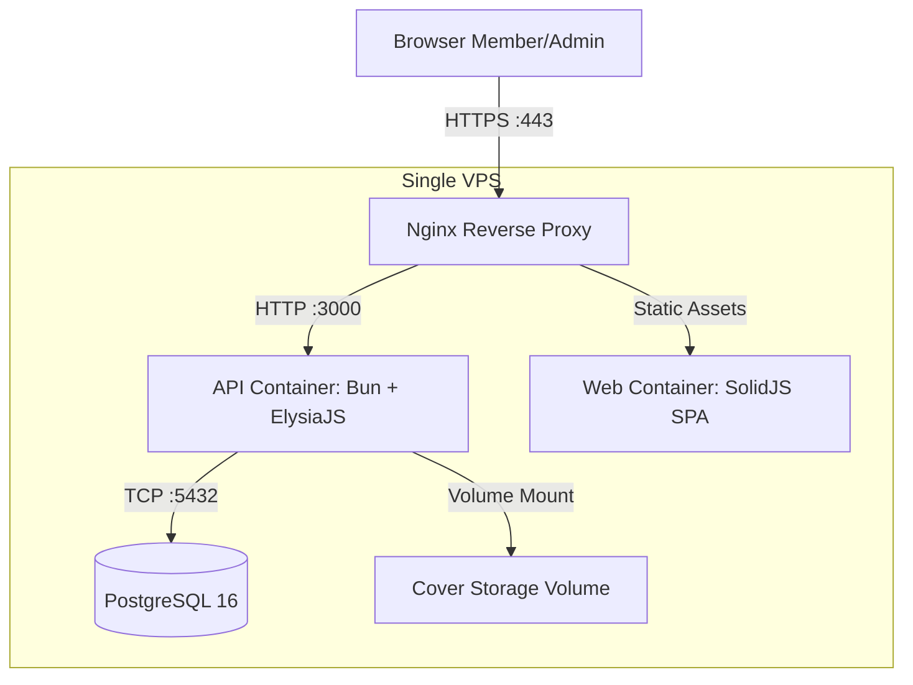

**Version:** 0.1  
**Date:** 2026-11-05  
**Author:** Tech Lead  
**Status:** Draft  
**Phase:** Deployment Plan  

# Infrastructure - ReadOnly

Dokumen ini menjelaskan topologi infrastruktur, layanan container, dan konfigurasi jaringan untuk sistem ReadOnly.

## 1. Topologi (Single VPS, P-16)

Sistem ReadOnly di-deploy pada satu VPS tunggal (Single Node) menggunakan Docker Compose. Reverse proxy Nginx bertugas sebagai pintu masuk lalu lintas HTTPS.

## 2. Layanan Docker Compose

| Layanan | Image / Build | Port Internal | Volume | Keterangan |
| --- | --- | --- | --- | --- |
| `nginx` | `nginx:alpine` | 80, 443 | `./docker/nginx.conf:/etc/nginx/nginx.conf:ro` | Reverse proxy, terminasi TLS, redirect HTTP ke HTTPS |
| `api` | Build `apps/api` | 3000 | `covers:/data/covers` | ElysiaJS API pada runtime Bun |
| `web` | Build `apps/web` | 80 | - | SolidJS SPA di-serve oleh Nginx internal container |
| `db` | `postgres:16-alpine` | 5432 | `pgdata:/var/lib/postgresql/data` | PostgreSQL 16 |

### Volume Docker

- `pgdata`: data persisten PostgreSQL. Jangan dihapus saat update container.
- `covers`: penyimpanan file gambar cover buku (SEC-05). Path di dalam container API: `/data/covers`.

## 3. Konfigurasi Nginx (Reverse Proxy)

Nginx bertugas:
1. Meneruskan request `/api/v1/*` ke container `api:3000`.
2. Meneruskan request lainnya ke container `web:80` (SPA fallback ke `index.html`).
3. Menambahkan header keamanan (SEC-08):
   - `X-Content-Type-Options: nosniff`
   - `X-Frame-Options: DENY`
   - `Referrer-Policy: strict-origin-when-cross-origin`
   - `Content-Security-Policy: default-src 'self'`
4. Memaksa redirect HTTP ke HTTPS untuk Staging dan Production.

## 4. Resource Sizing (Provisional, Q-32)

Target skala provisional: 10.000 judul buku, 1.000 member, 50.000 riwayat pinjaman.

| Komponen | CPU (vCPU) | RAM | Disk |
| --- | --- | --- | --- |
| VPS Total | 2 | 4 GB | 40 GB SSD |
| PostgreSQL | 1 | 1.5 GB | 20 GB |
| API Bun | 0.5 | 512 MB | - |
| Nginx + Web | 0.5 | 256 MB | - |

> [ASSUMED Q-32]: Ukuran ini adalah perkiraan awal. Perlu penyesuaian berdasarkan hasil uji beban setelah aplikasi berjalan.

## 5. Backup dan Persistensi

- **Database:** dump harian `pg_dump` ke direktori di luar volume Docker, retensi 7 hari.
- **Cover:** backup volume `covers` bersamaan dengan dump database (rsync atau tar).
- **Jadwal:** cron host (bukan di dalam container API) pukul 02:00 WIB.

## Cross-References

- [01-environments.md](01-environments.md)
- [03-initial-deployment.md](03-initial-deployment.md)
- [../technical-specs/02-system-architecture.md](../technical-specs/02-system-architecture.md)
- [../technical-specs/17-cover-upload-and-storage.md](../technical-specs/17-cover-upload-and-storage.md)
