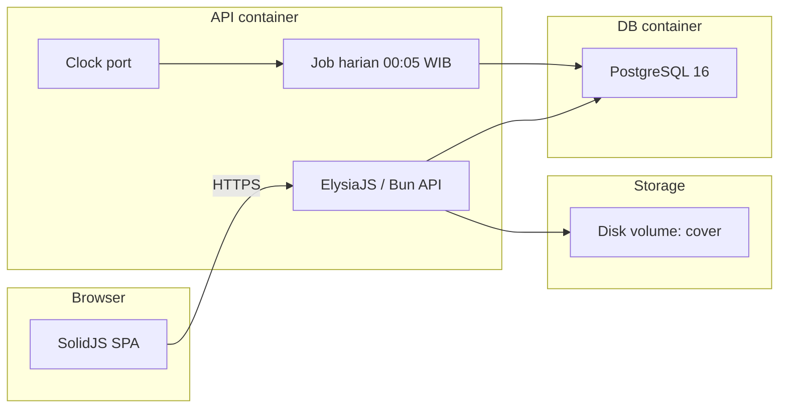
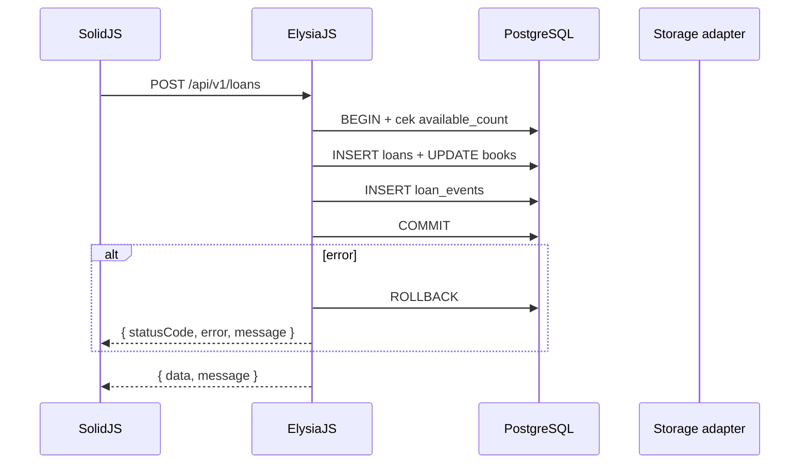
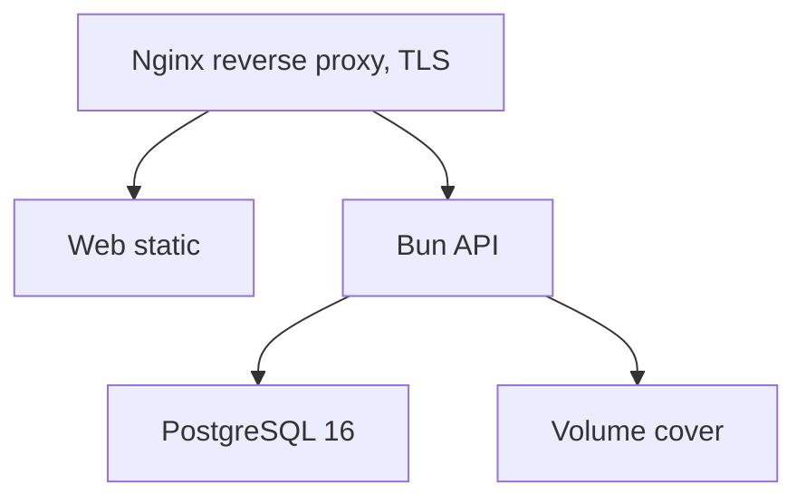

**Version:** 0.1
**Date:** 2026-11-05
**Author:** Tech Lead
**Status:** Draft
**Phase:** Technical Specification

# System Architecture - ReadOnly

## Why This Shape

Modular monolith: satu repository Bun workspaces dengan satu proses API Bun, satu SPA SolidJS, satu container PostgreSQL. Alasan:

- Tim kecil (TL, BE1, FE1); tidak ada kebutuhan scaling independen per modul (P-07, P-08).
- Memudahkan shared validation schema di `packages/shared` dan shared konstanta bisnis.
- Deploy sederhana: Docker Compose satu VPS (P-16).
- Transisi ke microservice mahal dan berisiko; modular monolith menunda keputusan itu sampai ada bukti skalabilitas.

## Komposisi komponen

## Siklus request

## Peta batas modul dan aturan panggil

| Modul | Dimiliki | Panggilan ke modul lain |
| --- | --- | --- |
| auth | API | users (read role) |
| books | API | genres (read), loan_events (append) |
| loans | API | books (conditional update), notifications (insert), loan_events (append) |
| notifications | API | users (read), loans (read) |
| dashboard | API | loans, books (read only) |
| system | API | - |
| jobs | API | loans, notifications |
| shared | packages/shared | dibaca semua modul |

**Aturan:** modul tidak mengimpor kode internal modul lain. Komunikasi lintas modul hanya melalui port yang didefinisikan di `05-module-definitions.md` (Storage, Clock, notification port).

## Deployment graph

## Cross-References

- [03-repository-structure.md](03-repository-structure.md)
- [04-tech-stack.md](04-tech-stack.md)
- [05-module-definitions.md](05-module-definitions.md)
- [06-data-model.md](06-data-model.md)
- [docs/deployment-plan/02-infrastructure.md](../deployment-plan/02-infrastructure.md)

## Open Follow-ups

Q-33 (pustaka UI), Q-18 (implementasi render QR: server vs klien).
