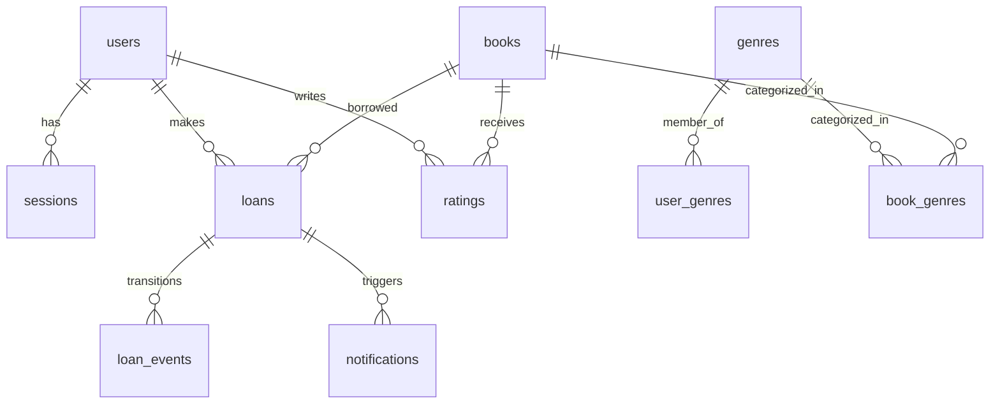

**Version:** 0.2
**Date:** 2026-11-09
**Author:** Tech Lead
**Status:** Diselaraskan dengan kontrak API
**Phase:** Technical Specification

# Data Model - ReadOnly

## ERD



## Tabel entitas

### users

| kolom | type | nullable | default | key | notes |
| --- | --- | --- | --- | --- | --- |
| id | uuid | no | gen_random_uuid() | PK | |
| full_name | text | no | | | ditampilkan pada daftar Management User (AC-12.01) |
| email | text | no | | UNIQUE | Q-08 |
| password_hash | text | no | | | bcrypt (Q-04) |
| address | text | yes | | | wajib saat registrasi Member; akun Admin baru tidak memerlukan alamat; hanya Admin yang dapat mengubah alamat Member (AC-12.02, AC-12.05) |
| phone_number | text | no | | | mandatory saat registrasi; tampil terbatas di Management User (AC-12.01, AC-12.05) |
| role | text | no | 'member' | | `'member'` / `'admin'`; `role` dan `email` tidak dapat diubah melalui Management User (AC-12.05) |
| status | text | no | 'active' | | `'active'` / `'inactive'` (AC-12.06–AC-12.08); akun inactive ditolak saat login (AC-12.07) |
| created_at | timestamptz | no | now() | | UTC |

### sessions

| kolom | type | nullable | default | key | notes |
| --- | --- | --- | --- | --- | --- |
| id | uuid | no | gen_random_uuid() | PK | |
| user_id | uuid | no | | FK → users | |
| token_hash | text | no | | UNIQUE | hash session secret, HttpOnly Secure SameSite=Lax (P-12) |
| expires_at | timestamptz | no | now() + interval | | |
| created_at | timestamptz | no | now() | | UTC |

### genres

| kolom | type | nullable | default | key | notes |
| --- | --- | --- | --- | --- | --- |
| id | uuid | no | gen_random_uuid() | PK | |
| name | text | no | | unique normalized | duplikat tidak peka kapitalisasi dan mengabaikan spasi awal/akhir (`LOWER(TRIM(name))`, AC-11.04) |
| status | text | no | 'active' | | `'active'` / `'inactive'`; hanya genre aktif untuk pilihan baru, data buku/preferensi yang sudah ada tetap (AC-05.10, AC-11.02, AC-11.06, AC-11.07) |
| created_at | timestamptz | no | now() | | UTC |

### user_genres

| kolom | type | nullable | default | key | notes |
| --- | --- | --- | --- | --- | --- |
| user_id | uuid | no | | FK → users | PK compound |
| genre_id | uuid | no | | FK → genres | PK compound (ON DELETE RESTRICT untuk guard AC-11.09) |

### books

| kolom | type | nullable | default | key | notes |
| --- | --- | --- | --- | --- | --- |
| id | uuid | no | gen_random_uuid() | PK | |
| title | text | no | | | Q-14: tanpa UNIQUE judul v1 |
| author | text | no | | | |
| publisher | text | no | | | |
| publication_year | int | no | | | |
| synopsis | text | no | | | |
| available_count | int | no | 0 | CHECK >= 0 | Q-09, diubah atomik |
| cover_path | text | yes | | | Storage port |
| deleted_at | timestamptz | yes | | | soft delete (Q-11) |
| created_at | timestamptz | no | now() | | UTC |

### book_genres

| kolom | type | nullable | default | key | notes |
| --- | --- | --- | --- | --- | --- |
| book_id | uuid | no | | FK → books | PK compound |
| genre_id | uuid | no | | FK → genres | PK compound (ON DELETE RESTRICT untuk guard AC-11.09) |

### loans

| kolom | type | nullable | default | key | notes |
| --- | --- | --- | --- | --- | --- |
| id | uuid | no | gen_random_uuid() | PK | |
| loan_no | text | no | generated | UNIQUE | `PJM-YYYYMMDD-####` (Q-36) |
| user_id | uuid | no | | FK → users | |
| book_id | uuid | no | | FK → books | |
| status | text | no | 'PENDING' | | `'PENDING'` \| `'BORROWED'` \| `'OVERDUE'` \| `'RETURN_PENDING'` \| `'FINE_PENDING'` \| `'RETURNED'` (dipetakan ke label UI sesuai GLOSSARY) |
| requested_at | timestamptz | no | now() | | UTC |
| confirmed_at | timestamptz | yes | | | |
| confirmed_by | uuid | yes | | FK → users | Admin |
| due_date | date | yes | | | diisi saat konfirmasi QR: `confirmed_at` + 7 hari WIB |
| return_requested_at | timestamptz | yes | | | membekukan `late_days` (Q-19) |
| returned_at | timestamptz | yes | | | |
| return_confirmed_by | uuid | yes | | FK → users | Admin |
| late_days | int | no | 0 | | dibekukan saat `return_requested_at` |
| fine_amount | int | yes | | | `0` (tepat waktu), `2000` (1–4 hari), `null` (>=5 hari sebelum diinput), atau `1..99999999` setelah diinput (Q-20, Q-21) |
| fine_status | text | yes | 'Belum Bayar' | | `'Belum Bayar'` / `'Sudah Bayar'` |
| fine_paid_at | timestamptz | yes | | | |
| fine_paid_by | uuid | yes | | FK → users | Admin |
| qr_token_hash | text | yes | | | SHA-256 hash dari token 128-bit CSPRNG |
| manual_code_hash | text | yes | | | SHA-256 hash dari kode konfirmasi manual (`PJM-XXXXXX`, fallback tanpa kamera, sekali pakai) |
| qr_consumed_at | timestamptz | yes | | | ditandai saat token QR atau kode manual dikonfirmasi (sekali pakai) |

### loan_events (append-only)

| kolom | type | nullable | default | key | notes |
| --- | --- | --- | --- | --- | --- |
| id | uuid | no | gen_random_uuid() | PK | |
| loan_id | uuid | no | | FK → loans | |
| from_status | text | yes | | | `null` saat pembuatan `PENDING` awal |
| to_status | text | no | | | kode status tujuan |
| actor_id | uuid | yes | | FK → users | `null` bila transisi oleh job sistem (`status_overdue`) |
| created_at | timestamptz | no | now() | | UTC |

### ratings

| kolom | type | nullable | default | key | notes |
| --- | --- | --- | --- | --- | --- |
| id | uuid | no | gen_random_uuid() | PK | |
| loan_id | uuid | no | | FK → loans, UNIQUE | 1 rating per peminjaman |
| book_id | uuid | no | | FK → books | memudahkan agregasi rata-rata rating buku |
| user_id | uuid | no | | FK → users | Member pemberi rating |
| score | int | no | | CHECK 1..5 | wajib saat ajukan pengembalian (AC-09.06) |
| created_at | timestamptz | no | now() | | UTC |

### notifications

| kolom | type | nullable | default | key | notes |
| --- | --- | --- | --- | --- | --- |
| id | uuid | no | gen_random_uuid() | PK | |
| loan_id | uuid | no | | FK → loans | |
| user_id | uuid | no | | FK → users | pemilik notifikasi |
| type | text | no | | | `'DUE_SOON_3D'` \| `'DUE_TODAY'` \| `'OVERDUE'` |
| title | text | no | | | judul/ringkasan notifikasi |
| text | text | no | | | template verbatim sesuai AC-10.01–AC-10.03 |
| is_read | boolean | no | false | | belum di-AC, follow-up Q-29 |
| created_at | timestamptz | no | now() | | UTC |
| UNIQUE (loan_id, type) | | | | | idempotensi job (Q-30) |

### job_runs

| kolom | type | nullable | default | key | notes |
| --- | --- | --- | --- | --- | --- |
| id | uuid | no | gen_random_uuid() | PK | |
| job_name | text | no | | | `'status_overdue'` \| `'notifications'` |
| started_at | timestamptz | no | now() | | UTC |
| finished_at | timestamptz | yes | | | |
| rows_affected | int | yes | | | |

## Contoh tipe TypeScript (Drizzle schema)

```ts
export const books = pgTable('books', {
  id: uuid('id').primaryKey().defaultRandom(),
  title: text('title').notNull(),
  author: text('author').notNull(),
  publisher: text('publisher').notNull(),
  publicationYear: integer('publication_year').notNull(),
  synopsis: text('synopsis').notNull(),
  availableCount: integer('available_count').notNull().default(0).$type<number>(),
  coverPath: text('cover_path'),
  deletedAt: timestamp('deleted_at', { withTimezone: true }),
  createdAt: timestamp('created_at', { withTimezone: true }).notNull().defaultNow(),
});
```

## Migrations and seeding

Satu perintah migrate dan satu perintah seed menyelesaikan path sendiri, membaca connection string dari environment:

```text
bun run db:migrate  # pgmigrate dari packages/db/drizzle.config.ts, DATABASE_URL
bun run db:seed     # packages/db/seeds/*.ts, idempoten, --env dev|qa
```

Larangan (hard rule):

- Dilarang path absolut hardcode ke file `.sql`.
- Dilarang connection string inline di kode.
- Dilarang membaca file `.sql` mentah tanpa migrasi.

Seed dev dan seed QA terpisah (`dev.ts`, `qa.ts`), keduanya idempoten dan dikontrol versi di `packages/db/seeds/`. Seeder dapat menyediakan Admin awal untuk bootstrap; setelah sistem berjalan, Admin dapat menambahkan akun Admin melalui AC-12.02. Genre awal dapat di-seed, lalu dikelola Admin melalui US-11.

## State machine entitas lifecycle

Merujuk [12-loan-lifecycle-and-fines.md](12-loan-lifecycle-and-fines.md).

## Cross-References

- [05-module-definitions.md](05-module-definitions.md)
- [12-loan-lifecycle-and-fines.md](12-loan-lifecycle-and-fines.md)
- [13-stock-integrity-and-concurrency.md](13-stock-integrity-and-concurrency.md)
- [docs/deployment-plan/06-database-reset.md](../deployment-plan/06-database-reset.md)

## Open Follow-ups

Q-11 (detail soft-delete), Q-16, Q-17, kebijakan sesi saat user dinonaktifkan, dan strategi bootstrap Admin pertama. Genre kini dikelola melalui US-11; lihat grooming final.
