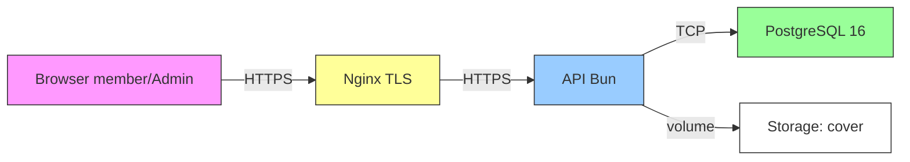

**Version:** 0.1
**Date:** 2026-11-05
**Author:** Tech Lead
**Status:** Draft
**Phase:** Technical Specification

# Security - ReadOnly

Setiap kontrol diberi ID `SEC-NN`; coding-standard dan code-review-checklist menautkan satu item per ID.

## Batas kepercayaan dan threat model

| Batas kepercayaan | Ancaman utama | Kontrol |
| --- | --- | --- |
| Browser → API | CSRF, token theft | SEC-03, SEC-07 |
| API → database | SQLi, akses berlebihan | SEC-04, SEC-08 |
| API → cover storage | File upload, eksposur path | SEC-05 |
| Permukaan admin | RBAC bypass, akses objek | SEC-01, SEC-02 |
| Kamera browser | Context permission, scraping | SEC-13 |

## Kontrol

### 7.1 Authentication dan sesi

#### 7.2.1 SEC-01: Kebijakan hash password

- Password di-hash bcrypt di API sebelum disimpan. Salto diatur di environment (misal 11) dan dibaca dari satu tempat; tidak ada bcrypt call di repository.
- Referensi: [coding-standard/09-keamanan-dan-rahasia.md#91-hash-password](../coding-standard/09-keamanan-dan-rahasia.md#91-hash-password).

### 7.2 RBAC dan otorisasi

#### 7.2.1 SEC-02: RBAC pada setiap route

- Semua route dilindungi middleware `requireAuth`; route admin dilindungi `requireRole('admin')`. Middleware mengecek sesi aktif di `sessions` sebelum mengeksekusi handler.
- Referensi: [09-authentication-and-authorization.md](09-authentication-and-authorization.md).

#### 7.2.2 SEC-03: Atribut cookie sesi

- Cookie HttpOnly, Secure, SameSite=Lax. Token sesi di-hash di database (`sessions.token_hash`), tidak dikirim ke klien. Logout menghapus baris sesi server-side.

#### 7.2.3 SEC-04: Proteksi CSRF untuk request pengubah state

- Semua request POST/PUT/PATCH/DELETE memerlukan header `Sec-Fetch-Site: same-origin` atau token CSRF pada cookie first-party. Endpoint admin wajib cek `origin` header.

#### 7.2.4 SEC-05: Otorisasi tingkat objek

- Member hanya membaca dan bertindak atas peminjaman miliknya sendiri (`WHERE user_id = :current`). Admin Perpus dapat melihat semua pinjaman. Cek dilakukan di repository (level data), bukan hanya handler.

### 7.3 Otentikasi masuk

#### 7.3.1 SEC-06: Rate limit login, register, scan QR

- Login: N percobaan gagal per IP dalam W menit → HTTP 429 (`rate_limit_exceeded`). Register: rate limit per IP. Scan QR: rate limit per IP agar token preview tidak dipaksa. Teks pesan batas: `[COPY-TBD Q-04]`.
- Referensi: [coding-standard/09-keamanan-dan-rahasia.md](../coding-standard/09-keamanan-dan-rahasia.md).

#### 7.2.5 SEC-07: Validasi input berbasis skema

- Semua input divalidasi oleh skema `packages/shared`, tidak ada `req.body` mentah yang diproses. Response error membawa `code` Inggris besar dan `message` bahasa UI.

#### 7.2.6 SEC-08: CORS, CSP, header keamanan

- CORS hanya mengizinkan origin aplikasi (dari env); CSP default `default-src 'self'`; header: `X-Content-Type-Options: nosniff`, `X-Frame-Options: DENY`, `Referrer-Policy: strict-origin-when-cross-origin`.

#### 7.2.7 SEC-09: Penanganan error tanpa kebocoran detail

- Error internal → HTTP 500 dengan `message: "Internal server error"`; stack trace hanya ke log (tidak ke client). Message catalog di [api-specs/01-conventions.md](../api-specs/01-conventions.md).

#### 7.2.8 SEC-10: Jejak audit

- `loan_events` append-only mencatat setiap transisi status (from/to/status/actor_id). `fine_paid_at/fine_paid_by` mencatat pembayaran denda.

#### 7.2.9 SEC-11: Integritas nominal denda

- Kasus 1–4 hari dihitung server (`calculateFine`). Input Admin (≥5 hari) divalidasi bilangan bulat 1..99.999.999. Admin tidak boleh menetapkan nominal di bawah perhitungan otomatis.

#### 7.2.10 SEC-12: Keamanan token QR

- Token 128 bit acak kriptografis (crypto.getRandomValues), di-hash (SHA-256) sebelum disimpan di `qr_token_hash`. Konsumsi token menghapus hash (sekali pakai). QR tidak pernah masuk log.

### 7.4 Deployment dan operasional

#### 7.2.11 SEC-13: Kebijakan endpoint operasional

- `POST /admin/reset-state` **tidak terdaftar di production**. Ditegaskan di registrasi route (`if (APP_ENV === 'production') app.ignore('/admin/reset-state')`) dan bukan hanya lewat otorisasi. `GET /health` terdaftar di semua lingkungan dengan rincian dibatasi.

#### 7.2.12 SEC-14: Manajemen secret

- Rahasia (sesi secret, DB credentials, bcrypt salt) dari environment variables, bukan dari repo atau `.env` committed. Seed Admin kredensial dari env (Q-02).

#### 7.2.13 SEC-15: Minimisasi PII

- Alamat dan nomor ponsel tidak masuk log atau Dashboard. Nomor ponsel boleh muncul pada daftar Management User Admin sesuai AC-12.01; alamat/nomor ponsel hanya boleh diakses pada konteks edit user yang diotorisasi sesuai AC-12.05. Semua endpoint tetap menerapkan RBAC Admin.

#### 7.2.14 SEC-16: Risiko enumerasi akun yang diterima

- AC-02.02/AC-02.03 menampilkan pesan berbeda ("email and Password tidak sama" vs "Email Not Registered"). Ini mengizinkan enumerasi akun. BA sudah setuju; mitigasi: rate limit login (SEC-06). Dicatat sebagai risiko diterima.

#### 7.2.15 SEC-17: Izin kamera dan HTTPS

- Akses kamera browser hanya pada secure context (HTTPS). Development: `localhost` dikecualikan (Q-01).

## Cross-References

- [coding-standard/09-keamanan-dan-rahasia.md](../coding-standard/09-keamanan-dan-rahasia.md)
- [code-review-checklist/04-security.md](../code-review-checklist/04-security.md)
- [09-authentication-and-authorization.md](09-authentication-and-authorization.md)
- [api-specs/01-conventions.md](../api-specs/01-conventions.md)

## Open Follow-ups

Q-04 (teks pesan rate limit), Q-15 (pesan 409 stok), dan keputusan apakah penonaktifan user harus mencabut sesi aktif.
